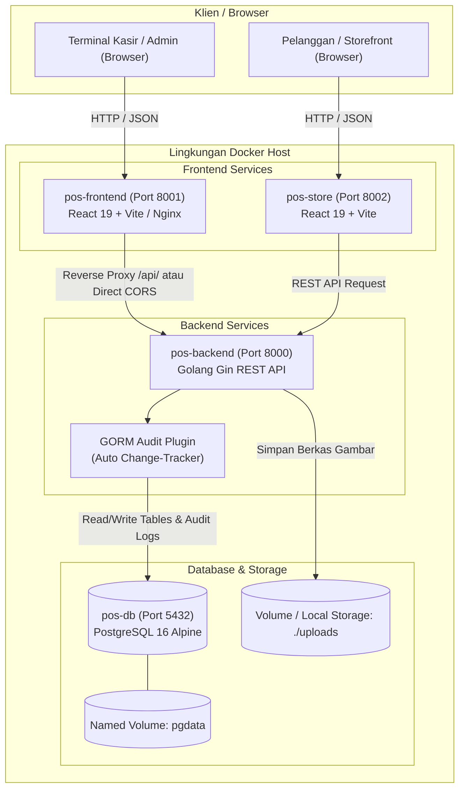
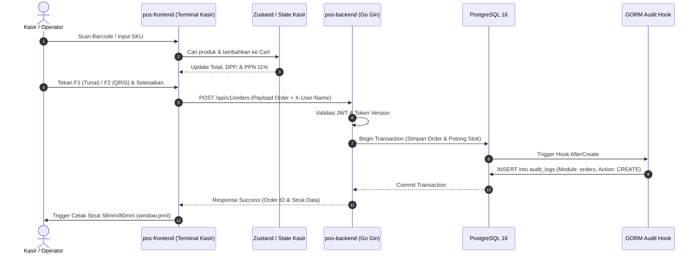

# Arsitektur Sistem POS Enterprise

Dokumen ini mendokumentasikan arsitektur teknis menyeluruh dari sistem POS Enterprise, mencakup integrasi antara antarmuka kasir/admin (**pos-frontend**), REST API service (**pos-backend**), serta basis data relasional (**PostgreSQL**).

---

## 1. Ikhtisar Arsitektur Tingkat Tinggi (High-Level Architecture)

Sistem POS Enterprise dirancang menggunakan model arsitektur **Client-Server terdistribusi berbasis kontainer (Containerized Microservices-ready)**. Setiap komponen memiliki isolasi fungsional dan beroperasi dalam satu jaringan Docker bersama (`bridge`).



---

## 2. Topologi Jaringan & Port Kontainer

Semua layanan didefinisikan dalam `docker-compose.yml` dengan topologi berikut:

| Service | Container Name | Host Port | Internal Port | Deskripsi |
| :--- | :--- | :--- | :--- | :--- |
| **`pos-db`** | `serba-35k-pos-db` | `5432` | `5432` | Database utama PostgreSQL 16 Alpine |
| **`pos-backend`** | `serba-35k-pos-backend` | `8000` | `8000` | REST API Golang Gin + GORM |
| **`pos-dashboard`** | `pos-frontend` | `8001` | `80` (dev/nginx) | Dashboard Kasir & Admin (React 19) |
| **`pos-store`** | `serba-35k-pos-store` | `8002` | `80` (dev/vite) | Katalog Pembeli & Self-Order |

---

## 3. Arsitektur Backend (`pos-backend`)

Backend dibangun menggunakan **Go (Golang) v1.23+** dengan pendekatan arsitektur modular berlapis:

```
pos-backend/
├── main.go          --> Entry point, CORS middleware, global routing definition
├── config/          --> Inisialisasi koneksi DB & GORM plugin
├── handlers/        --> Controller layer pemrosesan HTTP request/response
├── models/          --> GORM database entity definitions & struct request/response
└── utils/           --> Helper JWT, audit, pagination, dan device hashing
```

### A. Alur Permintaan & Middleware (Request Pipeline)
Setiap request yang masuk melewati tahapan pipeline berikut:
1. **CORS Middleware (`corsMiddleware`):** Menangani header CORS (`Access-Control-Allow-Origin`, `Credentials`, allowed methods `GET, POST, PUT, PATCH, DELETE, OPTIONS`, custom header `X-User-Name`).
2. **Audit Actor Context Middleware:** Membaca header `X-User-Name` (default: "Fadhil") dan menyuntikkannya ke dalam Go `context.Context` request untuk ditangkap oleh GORM Audit Plugin.
3. **Authentication Middleware (`RequireAuth`):**
   - Mendeteksi token JWT melalui dua jalur: **HttpOnly Cookie** (`pos_jwt_token`) atau **Bearer Header** (`Authorization: Bearer <token>`).
   - Melakukan verifikasi kriptografis JWT Claims (HMAC SHA-256).
   - **Device Fingerprint Binding:** Menghitung hash SHA-256 dari `User-Agent` klien dan mencocokkannya dengan `DeviceHash` yang tersimpan pada payload JWT. Jika tidak cocok, akses ditolak (*session hijacking prevention*).
   - **Token Versioning Check:** Mengekstrak versi token dari database karyawan (`token_version`). Jika pengguna logout atau status diubah, versi token bertambah, sehingga token lama seketika tidak valid (*instant session revocation*).

### B. Mekanisme GORM Audit Plugin (`audit_plugin.go`)
Backend dilengkapi plugin kustom GORM yang mendaftar ke lifecycle callbacks GORM (`Create`, `Update`, `Delete`):
- Secara otomatis mendeteksi model yang sedang dimanipulasi.
- Merekam **Aktor/User** dari konteks request.
- Membaca nilai sebelum pembaruan (`OldValues`) dan sesudah pembaruan (`NewValues`) dalam format JSON.
- Menulis riwayat secara transparan ke tabel `audit_logs` tanpa perlu koding manual di setiap handler.

### C. Desain Skema & Relasi Database (PostgreSQL)
- **`products`**: Menyimpan SKU, Barcode, Kategori (`category_id` FK), Brand (`brand_id` FK), Shelf Location, Harga Jual, HPP (*Cost Price*), Stok, Stok Minimum, Varian Flag.
- **`product_variants` & `product_variant_types`**: Mendukung varian bertingkat (misal Ukuran & Warna) dengan relasi `OnDelete: CASCADE`.
- **`product_wholesale_prices`**: Skema tier harga grosir dinamis berdasarkan kuantitas beli (`min_qty`, `max_qty`, `unit_price`).
- **`categories`**: Struktur hirarki kategori mendukung parent-child (*tree structure* bertingkat) dilengkapi slug otomatis unik.
- **`brands` & `shelves`**: Manajemen merek dan lokasi rak display toko.
- **`employees` & `roles`**: Manajemen staf kasir/admin dengan PIN, role id, dan perizinan granular berbasis JSONB (`permissions`).
- **`orders`**: Transaksi penjualan kasir (kode order, metode, total, status).
- **`audit_logs`**: Log audit jejak digital seluruh aktivitas sistem.
- **`settings`**: Konfigurasi parameter toko.

---

## 4. Arsitektur Frontend (`pos-frontend`)

Frontend dibangun menggunakan arsitektur **Feature-Driven UI Architecture** berbasis React 19, TypeScript, dan Tailwind CSS v4.

```
pos-frontend/src/
├── features/        --> Modul bisnis terisolasi (UI, komponen spesifik, API calls)
│   ├── auth/        --> Login PIN, otentikasi sesi
│   ├── pos/         --> Terminal transaksi kasir (Keyboard & Barcode scanner first)
│   ├── products/    --> Manajemen produk, varian, harga grosir, katalog
│   ├── categories/  --> Manajemen kategori hirarkis (Tree view & modal)
│   ├── dashboard/   --> Ringkasan KPI, omzet, laba kotor FIFO
│   ├── reports/     --> Laporan penjualan, settlement, ekspor CSV
│   ├── audit-logs/  --> Log audit aktivitas
│   ├── employees/   --> Data staf kasir
│   ├── roles/       --> Hak akses peran kasir/supervisor/owner
│   └── settings/    --> Pengaturan operasional
├── components/      --> Komponen bersama (Layout, Sidebar, Header, DataTable, UI Kit)
├── stores/          --> Global State Management menggunakan Zustand
├── services/api/    --> HTTP Client wrapper (`apiFetch`) & payload security
├── utils/           --> Helper format mata uang, enkripsi sesi lokal, kompresor gambar
└── types/           --> Definisi tipe TypeScript yang ketat
```

### A. State Management & Data Fetching
- **Zustand (`useProductStore.ts`)**: Mengelola state global produk, pagination server-side (`page`, `limit`, `totalItems`, `totalPages`), filter pencarian, filter kategori, sorting, dan mutasi optimistik.
- **Local State (`React.useState` / `useEffect`)**: Mengelola state transaksional kasir seperti keranjang belanja (`cartItems`), mode pembayaran, modal supervisor, dan navigasi menu.

### B. Keamanan Klien & Enkripsi Sesi
- **Kriptografi Payload Login (`client.ts`)**: Payload login (username & PIN) dienkripsi menggunakan XOR stream + Base64 dengan timestamp dan nonce unik sebelum dikirimkan ke server guna mencegah manipulasi *plain-text*.
- **Enkripsi Peran Lokal (`secureSession.ts`)**: Data peran pengguna disandikan sebelum disimpan di `sessionStorage` untuk mencegah eskalasi hak akses ilegal di sisi DevTools browser.

### C. Reverse Proxy & Routing Produksi (Nginx)
Pada konfigurasi kontainer produksi:
- Nginx melayani file statis hasil kompilasi Vite (`/usr/share/nginx/html`).
- **SPA Fallback Routing**: `try_files $uri $uri/ /index.html;` memungkinkan URL navigasi React Router DOM (`/pos`, `/products`, `/reports`) diakses langsung tanpa error 404.
- **Reverse Proxy `/api/`**: Meneruskan permintaan API secara transparan ke `http://pos-backend:8000` dan menginjeksi header identitas IP dan user.

---

## 5. Ringkasan Alur Data Transaksi POS


