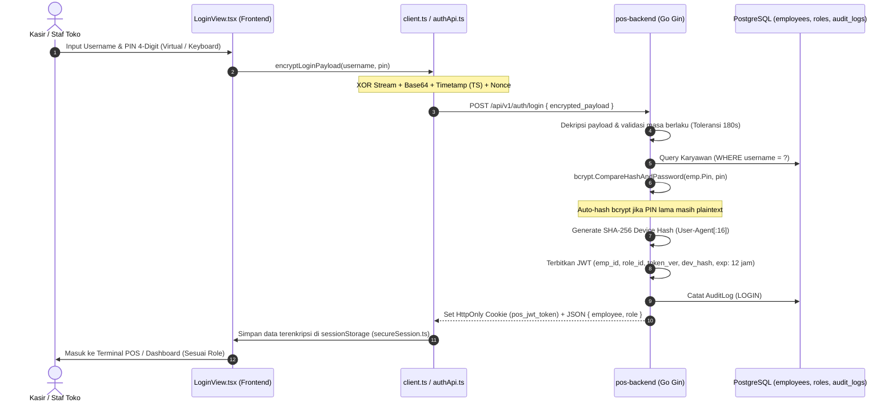

# Modul 1: Autentikasi, Manajemen Karyawan & Kontrol Hak Akses (RBAC)

Dokumen ini menjelaskan spesifikasi fungsional, arsitektur teknis, protokol keamanan kriptografis, dan skema basis data untuk **Modul Autentikasi dan Role-Based Access Control (RBAC)** pada ekosistem POS Enterprise.

---

## 1. Ikhtisar & Tujuan Bisnis (Overview)

Sistem POS ritel memerlukan proteksi ketat pada terminal kasir fisik dan panel administratif untuk mencegah:
- Manipulasi transaksi laci kasir (*cash skimming* atau void fiktif).
- Akses tidak sah antar kasir yang bertukar sesi (*session impersonation*).
- Eksploitasi hak akses lokal melalui modifikasi browser *Local/SessionStorage*.

Modul ini mengimplementasikan mekanisme otentikasi **PIN 4-digit berbasis shift kasir**, proteksi sesi ganda (**HttpOnly Cookie + Device Binding**), pembatalan sesi instan (**Token Versioning**), serta kontrol perizinan berbutir halus (**Granular RBAC**) berbasis PostgreSQL JSONB.

---

## 2. Alur Kerja Autentikasi (Authentication Flow)



---

## 3. Rincian Mekanisme Keamanan Kriptografis

### A. Obfuscation Payload Login Sisi Klien (`client.ts`)
Sebelum data akun dikirim melalui HTTP, fungsi `encryptLoginPayload` melakukan:
1. Pembangkitan objek payload: `{ username, pin, ts: unix_timestamp, nonce: random_str }`.
2. Enkripsi XOR stream menggunakan secret key bersama `POS_AUTH_SECRET_NONCE_HANDSHAKE_2026`.
3. Konversi byte stream ke Base64.
4. **Proteksi Replay-Attack:** Backend memvalidasi `|now - payload.ts| <= 180 detik`. Jika paket ditangkap dan dikirim ulang setelah 3 menit, server menolaknya secara otomatis.

### B. Penyimpanan & Auto-Migrasi PIN Karyawan (`users.go`)
- PIN karyawan disimpan dalam bentuk hash `bcrypt` (`golang.org/x/crypto/bcrypt`).
- **Fitur Backward-Compatibility:** Jika data karyawan awal masih berformat teks polos (*plaintext*), saat login pertama yang berhasil, sistem secara otomatis mengonversinya menjadi hash `bcrypt` (default cost: 10) dan menyimpannya kembali ke basis data.
- Respon API selalu menyamarkan PIN menjadi `••••` sebelum dikirim ke klien.

### C. Proteksi Sesi JWT & Device Binding (`jwt.go` & `auth_middleware.go`)
1. **Dual Token Delivery:**
   - Utama: Disimpan di **HttpOnly, SameSite=Lax Cookie** bernama `pos_jwt_token` dengan masa aktif 43.200 detik (12 jam / 1 shift kerja).
   - Alternatif: Mendukung header `Authorization: Bearer <token>` untuk fleksibilitas klien non-browser.
2. **Device Fingerprint Binding (`GenerateDeviceHash`):**
   - Backend menghitung hash SHA-256 dari header `User-Agent` klien dan mengambil 16 karakter pertama.
   - Hash ini disematkan di dalam klaim JWT (`dev_hash`).
   - Setiap request API diverifikasi ulang. Jika token dicuri dan dijalankan di browser/perangkat berbeda, middleware `RequireAuth` langsung mengembalikan `HTTP 401: Sesi tidak valid untuk perangkat/browser ini`.

### D. Pembatalan Sesi Instan (*Instant Revocation via Token Versioning*)
- Tabel `employees` memiliki kolom `token_version` (integer).
- Setiap klaim JWT menyimpan `token_ver` saat login.
- Ketika supervisor menonaktifkan akun kasir (`ToggleEmployeeStatus`), sistem otomatis mengeksekusi `emp.TokenVersion += 1`.
- Seluruh token aktif milik kasir tersebut seketika menjadi tidak berlaku tanpa perlu menunggu masa kedaluwarsa 12 jam.

### E. Enkripsi Peran Sesi Klien (`secureSession.ts`)
- Mencegah pengguna memanipulasi *Local/SessionStorage* via browser DevTools untuk meningkatkan izin (*privilege escalation*).
- Data izin disimpan di `sessionStorage` menggunakan kunci gabungan dari:
  $$\text{Key} = \text{SALT} + \text{UserId} + \text{BrowserFingerprint}(\text{UA, bahasa, resolusi, timezone})$$
- Jika data `sessionStorage` disalin ke browser lain, proses dekripsi akan gagal (`null`).

---

## 4. Model Kontrol Akses Berbasis Peran (RBAC)

### A. Peran Bawaan Sistem (*System Roles*)
1. **Owner / Administrator (`role-owner`):**
   - Akses mutlak ke seluruh modul: Dashboard, POS, Produk, Mutasi Stok, Kategori, Laporan, Audit Trail, Pengguna, dan Pengaturan.
2. **Supervisor (`role-supervisor`):**
   - Akses operasional toko, otorisasi void transaksi kasir, koreksi stok opname, dan laporan finansial.
3. **Kasir (`role-cashier`):**
   - Akses terbatas pada Terminal Kasir (`/pos`), input kas kecil masuk/keluar (*petty cash*), dan cetak struk. Dibatasi dari laporan laba kotor, manajemen pengguna, dan penghapusan produk.

### B. Matriks Perizinan Granular (`AppPermission`)
Izin disimpan dalam format JSON array pada kolom `roles.permissions`:

| Kunci Izin (*Permission Key*) | Deskripsi Fungsional |
| :--- | :--- |
| `pos.access` | Mengakses antarmuka terminal kasir |
| `pos.discount` | Memberikan diskon manual pada transaksi |
| `pos.void` | Membatalkan transaksi aktif (wajib PIN Supervisor) |
| `pos.exchange` | Memproses retur/tukar barang |
| `pos.petty_cash` | Menginput arus kas kecil (*Petty Cash In/Out*) |
| `products.view` | Melihat katalog produk toko |
| `products.create` | Menambah master produk baru |
| `products.edit` | Memperbarui harga, nama, dan varian produk |
| `products.delete` | Menghapus permanen produk dari sistem |
| `products.archive` | Mengarsipkan (soft-delete) SKU produk |
| `categories.manage` | Menambah, mengedit, dan menghapus kategori hirarkis |
| `stock.view` | Melihat kartu stok dan riwayat mutasi |
| `stock.adjust` | Melakukan penyesuaian stok manual (stok opname) |
| `reports.view` | Melihat laporan penjualan, omzet, dan margin laba |
| `reports.export` | Mengunduh berkas laporan format CSV |
| `audit.view` | Melihat jejak log aktivitas sistem |
| `users.manage` | Menambah dan menonaktifkan akun staf kasir |
| `roles.manage` | Mengatur perizinan matriks role |
| `settings.manage` | Memodifikasi konfigurasi toko dan struk thermal |

---

## 5. Skema Basis Data (Database Schema)

### Tabel `employees`
```sql
CREATE TABLE employees (
    id VARCHAR(255) PRIMARY KEY,
    name VARCHAR(255) NOT NULL,
    username VARCHAR(255) UNIQUE NOT NULL,
    pin VARCHAR(255) NOT NULL,
    role_id VARCHAR(255) NOT NULL,
    phone VARCHAR(50),
    is_active BOOLEAN DEFAULT TRUE,
    token_version INT DEFAULT 1,
    created_at TIMESTAMPTZ,
    updated_at TIMESTAMPTZ
);
```

### Tabel `roles`
```sql
CREATE TABLE roles (
    id VARCHAR(255) PRIMARY KEY,
    name VARCHAR(255) NOT NULL,
    description TEXT,
    is_system BOOLEAN DEFAULT FALSE,
    permissions JSONB NOT NULL DEFAULT '[]',
    created_at TIMESTAMPTZ,
    updated_at TIMESTAMPTZ
);
```

---

## 6. Daftar Endpoint REST API

| Method | Endpoint | Auth | Deskripsi |
| :--- | :--- | :--- | :--- |
| `POST` | `/api/v1/auth/login` | Publik | Otentikasi username & PIN, menerbitkan HttpOnly Cookie |
| `GET` | `/api/v1/auth/me` | Wajib | Verifikasi validitas sesi aktif dan mengembalikan data profil & role |
| `POST` | `/api/v1/auth/logout` | Wajib | Menghapus cookie sesi `pos_jwt_token` |
| `GET` | `/api/v1/roles` | Wajib | Mengambil daftar seluruh peran dan perizinannya |
| `POST` | `/api/v1/roles` | Wajib | Membuat peran kustom baru |
| `PUT` | `/api/v1/roles/:id` | Wajib | Memperbarui nama dan deskripsi peran non-sistem |
| `PUT` | `/api/v1/roles/:id/permissions` | Wajib | Memperbarui matriks hak akses array perizinan peran |
| `GET` | `/api/v1/employees` | Wajib | Mengambil seluruh daftar karyawan (PIN disamarkan) |
| `POST` | `/api/v1/employees` | Wajib | Mendaftarkan staf/kasir baru dengan PIN terenkripsi |
| `PUT` | `/api/v1/employees/:id` | Wajib | Mengubah profil karyawan, role, atau PIN baru |
| `PATCH`| `/api/v1/employees/:id/toggle-status`| Wajib | Mengaktifkan/menonaktifkan akun & memutus sesi instan |

---

## 7. Indeks Berkas Sumber (Source Code References)

- Backend Handler & Router: [`pos-backend/handlers/users.go`](file:///D:/project/pos-enterprise/pos-backend/handlers/users.go)
- Backend Auth Middleware: [`pos-backend/handlers/auth_middleware.go`](file:///D:/project/pos-enterprise/pos-backend/handlers/auth_middleware.go)
- Backend JWT & Hashing Utility: [`pos-backend/utils/jwt.go`](file:///D:/project/pos-enterprise/pos-backend/utils/jwt.go)
- Backend Entity Models: [`pos-backend/models/user.go`](file:///D:/project/pos-enterprise/pos-backend/models/user.go)
- Frontend Login View: [`pos-frontend/src/features/auth/LoginView.tsx`](file:///D:/project/pos-enterprise/pos-frontend/src/features/auth/LoginView.tsx)
- Frontend Auth API Client: [`pos-frontend/src/features/auth/api/authApi.ts`](file:///D:/project/pos-enterprise/pos-frontend/src/features/auth/api/authApi.ts)
- Frontend Role Session Crypto: [`pos-frontend/src/utils/secureSession.ts`](file:///D:/project/pos-enterprise/pos-frontend/src/utils/secureSession.ts)
- Frontend Users & Role UI: [`pos-frontend/src/features/users/UsersView.tsx`](file:///D:/project/pos-enterprise/pos-frontend/src/features/users/UsersView.tsx)
