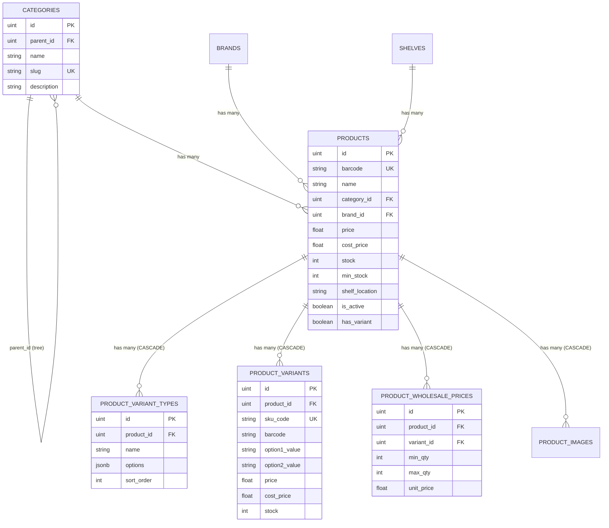

# Modul 2: Katalog Produk, Kategori, & Varian

Dokumen ini menjelaskan arsitektur teknis, logika bisnis, skema basis data, dan antarmuka API untuk **Modul Katalog Produk, Hirarki Kategori, dan Matriks Varian** pada sistem POS Enterprise.

---

## 1. Ikhtisar & Tujuan Bisnis (Overview)

Modul Katalog mengelola master data barang dagangan ritel dengan kemampuan:
- **Identifikasi Cepat:** Barcode scanning hardware-first dan penomoran SKU otomatis.
- **Struktur Harga Fleksibel:** Harga jual paten (baseline Rp35.000) maupun harga kustom, dilengkapi HPP (*Cost Price*) untuk kalkulasi margin laba kotor riil.
- **Matriks Multi-Varian Bertingkat:** Mendukung hingga 2 tipe opsi varian (misal: *Ukuran* & *Warna*) yang secara otomatis membentuk kombinasi SKU individual dengan harga, modal, stok, dan barcode mandiri.
- **Harga Grosir Bertingkat (*Tiered Wholesale*):** Aturan potongan harga kuantitatif berdasarkan ambang batas pembelian (`min_qty` s/d `max_qty`).
- **Hirarki Kategori (*Nested Category Tree*):** Pengelompokan barang dalam struktur bertingkat (Parent $\rightarrow$ Sub-Kategori) dengan slug URL-friendly otomatis.
- **Soft Archival (Arsip SKU):** Produk dinonaktifkan tanpa menghapus riwayat audit dan integritas laporan transaksi historis kasir.

---

## 2. Diagram Hubungan Entitas (ERD) Katalog



---

## 3. Logika Bisnis & Fitur Unggulan

### A. Matriks Varian Kombinatorial (`ProductVariationSection.tsx`)
1. Pengguna dapat mendefinisikan hingga 2 jenis varian (contoh: Tipe 1 = "Ukuran" dengan opsi `[S, M, L]`, Tipe 2 = "Warna" dengan opsi `[Hitam, Putih]`).
2. Frontend secara otomatis menghasilkan matriks kombinasi Cartesian:
   $$\text{Total Varian} = |\text{Options}_1| \times |\text{Options}_2|$$
3. Setiap baris varian memiliki:
   - **SKU Code:** Format standar `[BARCODE]-[OPT1]-[OPT2]`
   - **Barcode Mandiri:** Dapat di-scan langsung di kasir
   - **Harga Jual & HPP:** Mengesampingkan (*override*) harga default produk induk jika diisi
   - **Stok Khusus:** Menghitung total stok induk secara akumulatif

### B. Transaksi Pembaruan Atomik (`UpdateProduct` di `products.go`)
Pembaruan produk yang memiliki varian dan harga grosir dieksekusi dalam **Database Transaction (`tx := db.Begin()`)**:
1. Menghapus relasi anak lama secara terurut untuk mencegah konflik foreign key:
   - `DELETE FROM product_images WHERE product_id = ?`
   - `DELETE FROM product_wholesale_prices WHERE product_id = ?`
   - `DELETE FROM product_variants WHERE product_id = ?`
   - `DELETE FROM product_variant_types WHERE product_id = ?`
2. Memperbarui kolom data produk induk (`products`).
3. Memasukkan ulang varian baru, jenis varian, tier grosir, dan galeri gambar.
4. Jika salah satu operasi gagal, transaksi di-*rollback* penuh.

### C. Kategori Bertingkat & Slug Otomatis (`category.go`)
- **Query Pohon Hirarki:** Endpoint `GET /api/v1/categories?tree=true` melakukan *recursive preloading* (`Preload("Children.Children")`) dengan filter root `parent_id IS NULL`.
- **Generator Slug Unik (`EnsureUniqueSlug`):** Mengonversi nama kategori menjadi slug ramah URL dan mengecek keunikan di basis data (menambahkan sufiks `-1`, `-2` jika terjadi duplikasi).

### D. Kompresi & Upload Gambar Multi-Part (`upload.go` & `imageCompressor.ts`)
- Di sisi browser, gambar dikompresi melalui Canvas API (`maxWidth: 1200px`, `quality: 0.8`).
- Diunggah melalui `POST /api/v1/products/upload-image` (Multipart Form).
- Disimpan di direktori server `./uploads` dan disajikan statis melalui rute Gin `r.Static("/uploads", "./uploads")`.

### E. Mekanisme Arsip SKU (`ToggleArchiveProduct`)
- Mengubah status boolean `is_active = !is_active`.
- Produk yang diarsipkan **tidak muncul** pada pencarian kasir POS aktif, namun tetap tersimpan di basis data sehingga laporan penjualan lampau dan stok opname historis tidak mengalami *broken reference*.

---

## 4. Skema Basis Data (Database Schema)

```sql
-- Master Produk Induk
CREATE TABLE products (
    id SERIAL PRIMARY KEY,
    barcode VARCHAR(255) UNIQUE NOT NULL,
    name VARCHAR(255) NOT NULL,
    category_id INT REFERENCES categories(id) ON DELETE SET NULL,
    brand VARCHAR(100) DEFAULT 'Tidak Ada Merk',
    brand_id INT REFERENCES brands(id) ON DELETE SET NULL,
    condition VARCHAR(50) DEFAULT 'Baru',
    price DOUBLE PRECISION NOT NULL,
    cost_price DOUBLE PRECISION NOT NULL DEFAULT 0,
    stock INT DEFAULT 0,
    min_stock INT DEFAULT 5,
    unit VARCHAR(50) DEFAULT 'Pcs',
    shelf_location VARCHAR(100),
    is_active BOOLEAN DEFAULT TRUE,
    has_variant BOOLEAN DEFAULT FALSE,
    created_at TIMESTAMPTZ,
    updated_at TIMESTAMPTZ
);

-- Tipe Varian (Contoh: Warna, Ukuran)
CREATE TABLE product_variant_types (
    id SERIAL PRIMARY KEY,
    product_id INT NOT NULL REFERENCES products(id) ON DELETE CASCADE,
    name VARCHAR(100) NOT NULL,
    options JSONB DEFAULT '[]',
    sort_order INT DEFAULT 0
);

-- Item Varian Spesifik
CREATE TABLE product_variants (
    id SERIAL PRIMARY KEY,
    product_id INT NOT NULL REFERENCES products(id) ON DELETE CASCADE,
    sku_code VARCHAR(100) UNIQUE,
    barcode VARCHAR(100),
    option1_value VARCHAR(100),
    option2_value VARCHAR(100),
    price DOUBLE PRECISION DEFAULT 0,
    cost_price DOUBLE PRECISION DEFAULT 0,
    stock INT DEFAULT 0,
    image_url TEXT,
    created_at TIMESTAMPTZ,
    updated_at TIMESTAMPTZ
);

-- Aturan Harga Grosir
CREATE TABLE product_wholesale_prices (
    id SERIAL PRIMARY KEY,
    product_id INT NOT NULL REFERENCES products(id) ON DELETE CASCADE,
    variant_id INT REFERENCES product_variants(id) ON DELETE CASCADE,
    min_qty INT NOT NULL,
    max_qty INT,
    unit_price DOUBLE PRECISION NOT NULL,
    created_at TIMESTAMPTZ
);
```

---

## 5. Ringkasan Endpoint REST API

| Method | Endpoint | Auth | Parameter Query / Body | Deskripsi |
| :--- | :--- | :--- | :--- | :--- |
| `GET` | `/api/v1/products` | Wajib | `page`, `limit`, `search`, `category`, `status`, `sort_by`, `sort_dir` | Daftar katalog produk dengan server-side pagination & preloads |
| `GET` | `/api/v1/products/:barcode` | Wajib | Path: `barcode` | Detail produk lengkap beserta varian & grosir |
| `POST` | `/api/v1/products` | Wajib | JSON `ProductRequest` | Menambah produk baru ke katalog |
| `PUT` | `/api/v1/products/:barcode` | Wajib | JSON `ProductRequest` | Pembaruan atomik produk, varian, dan grosir |
| `PATCH`| `/api/v1/products/:barcode/archive` | Wajib | - | Toggle status aktif/arsip produk |
| `DELETE`| `/api/v1/products/:barcode` | Wajib | - | Hapus permanen produk dari sistem |
| `POST` | `/api/v1/products/upload-image` | Publik | Multipart file (`image`) | Upload berkas gambar produk ke server |
| `GET` | `/api/v1/categories` | Wajib | `tree=true`, `search`, `status` | Mengambil kategori (list datar atau hirarki pohon) |
| `POST` | `/api/v1/categories` | Wajib | JSON `{ name, parent_id, description }` | Menambah kategori baru dengan auto-slug |
| `PUT` | `/api/v1/categories/:id` | Wajib | JSON `{ name, parent_id, description }` | Memperbarui nama dan relasi kategori |
| `DELETE`| `/api/v1/categories/:id` | Wajib | - | Menghapus kategori master |
| `GET` | `/api/v1/brands` | Wajib | - | Daftar master merek terurut abjad |
| `POST` | `/api/v1/brands` | Wajib | JSON `{ name }` | Tambah merek baru (case-insensitive check) |
| `DELETE`| `/api/v1/brands/:id` | Wajib | - | Hapus master merek |
| `GET` | `/api/v1/shelves` | Wajib | - | Daftar lokasi rak display toko |
| `POST` | `/api/v1/shelves` | Wajib | JSON `{ name }` | Tambah lokasi rak display |
| `DELETE`| `/api/v1/shelves/:id` | Wajib | - | Hapus lokasi rak |

---

## 6. Indeks Berkas Sumber (Source Code References)

- Backend Product Handler: [`pos-backend/handlers/products.go`](file:///D:/project/pos-enterprise/pos-backend/handlers/products.go)
- Backend Category Handler: [`pos-backend/handlers/category.go`](file:///D:/project/pos-enterprise/pos-backend/handlers/category.go)
- Backend Brand Handler: [`pos-backend/handlers/brands.go`](file:///D:/project/pos-enterprise/pos-backend/handlers/brands.go)
- Backend Shelf Handler: [`pos-backend/handlers/shelves.go`](file:///D:/project/pos-enterprise/pos-backend/handlers/shelves.go)
- Backend Image Upload Handler: [`pos-backend/handlers/upload.go`](file:///D:/project/pos-enterprise/pos-backend/handlers/upload.go)
- Backend Product Model: [`pos-backend/models/product.go`](file:///D:/project/pos-enterprise/pos-backend/models/product.go)
- Backend Category Model: [`pos-backend/models/category.go`](file:///D:/project/pos-enterprise/pos-backend/models/category.go)
- Frontend Product Form: [`pos-frontend/src/features/products/ProductFormPage.tsx`](file:///D:/project/pos-enterprise/pos-frontend/src/features/products/ProductFormPage.tsx)
- Frontend Product Catalog View: [`pos-frontend/src/features/products/ProductsView.tsx`](file:///D:/project/pos-enterprise/pos-frontend/src/features/products/ProductsView.tsx)
- Frontend Categories View: [`pos-frontend/src/features/categories/CategoriesView.tsx`](file:///D:/project/pos-enterprise/pos-frontend/src/features/categories/CategoriesView.tsx)
- Frontend Zustand Product Store: [`pos-frontend/src/stores/useProductStore.ts`](file:///D:/project/pos-enterprise/pos-frontend/src/stores/useProductStore.ts)
