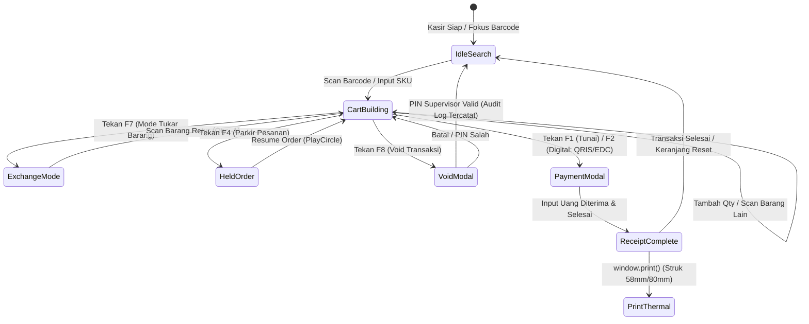

# Modul 3: Terminal Kasir POS & Transaksi Order

Dokumen ini menjelaskan arsitektur teknis, antarmuka keyboard-first, formula perpajakan dan finansial, otorisasi supervisor, serta integrasi pemrosesan order pada sistem POS Enterprise.

---

## 1. Ikhtisar & Tujuan Bisnis (Overview)

Terminal Kasir (*POS Terminal*) dirancang untuk kecepatan transaksi kasir ritel berintensitas tinggi (*high-speed checkout*). 
Prinsip utama desain antarmuka:
- **Zero-Mouse / Keyboard-First:** Seluruh navigasi, input barcode, pemilihan metode bayar, dan pembatalan dapat dieksekusi 100% menggunakan tombol fungsi keyboard (`F1` – `F9`).
- **Scanner Hardware Integration:** Input barcode otomatis difokuskan kembali (*auto-refocus*) setiap modal tertutup sehingga kasir dapat langsung menembakkan barcode scanner tanpa mengklik mouse.
- **Transparansi Pajak & Laba:** Kalkulasi otomatis DPP (Dasar Pengenaan Pajak), PPN 11% *item-level*, potongan fee MDR (QRIS & EDC), serta pemotongan HPP FIFO secara *real-time*.
- **Pencegahan Fraud Kasir:** Pembatalan transaksi (*Void*) mewajibkan otorisasi PIN Supervisor, dan tutup shift kasir menerapkan metode **Blind Closing** (kasir wajib memasukkan hitungan fisik tanpa melihat saldo ekspektasi sistem terlebih dahulu).

---

## 2. Diagram Alur Transaksi Kasir (Checkout State Machine)



---

## 3. Peta Pintasan Keyboard Kasir (Keyboard Shortcuts Matrix)

| Tombol | Fungsi Operasional | Keterangan & Proteksi Bisnis |
| :--- | :--- | :--- |
| **`Enter`** | Proses Barcode Input | Memvalidasi SKU/Barcode di katalog. Jika mode retur aktif, item bernilai `-1`. |
| **`F1`** | Bayar Tunai (*Cash*) | Membuka modal pembayaran tunai dan input nominal uang yang diterima pembeli. |
| **`F2`** | Bayar Digital (*QRIS / EDC*) | Membuka modal non-tunai dengan opsi QRIS (MDR 0.7%) atau EDC (MDR 1.5%). |
| **`F4`** | Parkir Pesanan (*Hold Order*) | Menyimpan keranjang belanja saat pembeli masih mengambil barang tambahan. |
| **`F6`** | Kas Laci (*Petty Cash*) | Pencatatan arus kas masuk (*In*) atau kas keluar (*Out*) untuk operasional kasir. |
| **`F7`** | Mode Tukar / Retur Barang | Menandai barang berikutnya sebagai retur konsumen dengan harga minus (-Rp 35.000). |
| **`F8`** | Void Transaksi | Membatalkan seluruh keranjang. **Wajib verifikasi PIN Supervisor** (demo: `1234`). |
| **`F9`** | Tutup Shift Kasir (*Shift Closing*) | Membuka antarmuka penghitungan fisik laci (*Blind Cash Counting*). |
| **`Esc`** | Batal / Tutup Modal | Menutup semua modal yang sedang terbuka dan mengembalikan fokus kursor ke pencarian. |

---

## 4. Formula Perhitungan Finansial & Perpajakan

### A. Perhitungan Pajak Pertambahan Nilai (PPN 11% Item-Level)
Sistem menggunakan pembulatan di tingkat item (*item-level rounding*) untuk mencegah selisih fraksi desimal:
$$\text{DPP} = \text{round}\left(\frac{\text{Subtotal Item}}{1 + 0.11}\right)$$
$$\text{PPN Item} = \text{Subtotal Item} - \text{DPP}$$
$$\text{Total Pajak Transaksi} = \sum \text{PPN Item}$$

### B. Pemisahan Merchant Discount Rate (MDR) Pembayaran Non-Tunai
Untuk mencerminkan pendapatan bersih (*Net Settlement*) yang masuk ke rekening toko:
- **QRIS:** MDR Rate = $0.7\%$ ($0.007$)
- **Mesin EDC:** MDR Rate = $1.5\%$ ($0.015$)
$$\text{MDR Fee} = \text{round}(\text{Gross Amount} \times \text{MDR Rate})$$
$$\text{Net Settlement} = \text{Gross Amount} - \text{MDR Fee}$$

### C. First-In, First-Out (FIFO) Cost Deduction
Saat transaksi berhasil diselesaikan:
1. Sistem menelusuri batch modal masuk stok tertua (`StockBatch`) yang memiliki `remainingQty > 0`.
2. Menghitung HPP riil:
   $$\text{Total COGS} = \sum (\text{Qty Diambil} \times \text{Harga Beli Batch})$$
3. Menghitung Laba Kotor Transaksi (*Gross Profit*):
   $$\text{Gross Profit} = \text{Gross Amount} - \text{Total COGS}$$

### D. Rekonsiliasi Tutup Shift Kasir (*Blind Shift Closing*)
Kasir menginput jumlah lembar/keping uang per pecahan fisik (Rp100.000 s/d Rp1.000).
- **Total Uang Fisik:**
  $$\text{Cash}_{\text{Fisik}} = \sum (\text{Nominal} \times \text{Jumlah Lembar})$$
- **Total Uang Ekspektasi Sistem:**
  $$\text{Cash}_{\text{Ekspektasi}} = \text{Modal Awal} + \text{Total Penjualan Tunai} + \text{Petty Cash In} - \text{Petty Cash Out}$$
- **Selisih Kas (*Variance*):**
  $$\Delta = \text{Cash}_{\text{Fisik}} - \text{Cash}_{\text{Ekspektasi}}$$
  *(Jika $\Delta < 0$, tercatat selisih kurang; jika $\Delta > 0$, tercatat selisih lebih).*

---

## 5. Spesifikasi Struk Thermal & Cetak (58mm / 80mm)

Sistem mengimplementasikan stylesheet CSS cetak khusus (`@media print`):
- Memiliki format lebar dinamis (default: 58mm, opsional 80mm).
- Header struk memuat nama toko, alamat, dan nomor kontak.
- Rincian item menampilkan: nama produk, qty, harga satuan, dan subtotal.
- Rincian finansial memuat: Subtotal, DPP, PPN 11%, Metode Pembayaran, Tunai Diterima, dan Kembalian.
- Footer struk memuat ucapan terima kasih dan syarat retur barang (maksimal 1x24 jam).
- Dipicu langsung via panggilan native browser: `window.print()`.

---

## 6. Integrasi Backend REST API (`POST /api/v1/orders`)

Pesanan kasir dapat disinkronkan ke PostgreSQL melalui API backend:
- **Endpoint:** `POST /api/v1/orders`
- **Header:** `Authorization: Bearer <token>`, `X-User-Name: <Nama Kasir>`
- **Request Body (JSON):**
  ```json
  {
    "customer_name": "Umum (Walk-in)",
    "phone": "081234567890",
    "order_method": "Ambil di Toko",
    "total_amount": 105000
  }
  ```
- **Response Success (`201 Created`):**
  ```json
  {
    "success": true,
    "message": "Pesanan berhasil dibuat dan tersimpan di database",
    "order_code": "TRX-20261123200845",
    "data": {
      "id": 142,
      "order_code": "TRX-20261123200845",
      "customer_name": "Umum (Walk-in)",
      "phone": "081234567890",
      "order_method": "Ambil di Toko",
      "total_amount": 105000,
      "created_at": "2026-11-23T20:08:45+07:00"
    }
  }
  ```

---

## 7. Indeks Berkas Sumber (Source Code References)

- Frontend Terminal Kasir View: [`pos-frontend/src/features/pos/PosView.tsx`](file:///D:/project/pos-enterprise/pos-frontend/src/features/pos/PosView.tsx)
- Frontend Logika Transaksi & FIFO: [`pos-frontend/src/App.tsx`](file:///D:/project/pos-enterprise/pos-frontend/src/App.tsx#L250-L350)
- Backend Order Handler: [`pos-backend/handlers/orders.go`](file:///D:/project/pos-enterprise/pos-backend/handlers/orders.go)
- Backend Order Model: [`pos-backend/models/order.go`](file:///D:/project/pos-enterprise/pos-backend/models/order.go)
- Types & Interfaces: [`pos-frontend/src/types/index.ts`](file:///D:/project/pos-enterprise/pos-frontend/src/types/index.ts)
